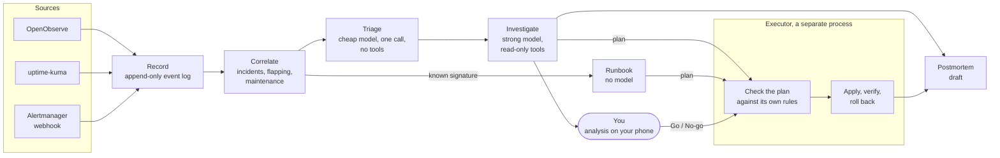

<div align="center">


### The on-call colleague for your self-hosted server

Alert triage, read-only investigation and approved remediation,<br>
with a hard line between what a model may **think** and what code may **do**.

[](https://github.com/mmornati/paeon/actions/workflows/ci.yml)
[](LICENSE)


**[Website](https://mmornati.github.io/paeon/)** · **[Documentation](https://mmornati.github.io/paeon/docs/)** · **[Videos](https://mmornati.github.io/paeon/#videos)**

[Quick start](#quick-start) · [How it works](#how-it-works) · [Acting](#acting) · [Safety](#safety-model) · [Privacy](#what-leaves-your-server) · [Roadmap](#roadmap) · [Design](docs/llm-incident-response-architecture.md)

</div>

---

It is 03:12. Your phone buzzes: `SLO fast burn`. Is it the nightly update again, or is the disk
really full this time?

**Paeon** (the healer of the gods in Homer) sits next to your alerting and answers that question
before you are awake enough to ask it. It listens to OpenObserve, uptime-kuma and anything that
speaks the Alertmanager webhook, groups alerts into incidents, asks a cheap model whether this is
noise, lets a strong model investigate with tools that can only read, and sends you what it found:
a root cause, the evidence for it, and a plan.

> [!IMPORTANT]
> **Out of the box Paeon takes no action on your server.** It records, correlates, triages,
> investigates and drafts postmortems. Acting is a second process you add on purpose, with a
> closed catalog of actions, and nothing runs without your Go until you say otherwise.
> It is alpha software, and the acting part has not yet run on a real server for long: run it
> next to your alerting, never instead of it.

## Why Paeon

- 🧠 **The model proposes, code disposes.** No shell, no free-form command, no write credential
  for a model, in any stage. A plan is a list of actions from a closed catalog, checked again by
  a separate executor that trusts nothing the model touched.
- 📱 **Go / No-go on your phone.** A signed, single-use, expiring button, bound to the exact plan.
  Opening the link never applies anything.
- 🎚️ **Autonomy is earned, per action and per container.** Paeon proposes a promotion after a
  record of verified runs; you make it, in git. One failure, one Undo or one "This was wrong"
  takes it back.
- 🔍 **Investigation with evidence.** Every claim in an analysis is tied to the tool call that
  supports it. A claim that cites no real call is marked as unverified.
- 🔒 **Allow-lists first, redaction second.** A log stream, a metric or a container that you did
  not list cannot be read, and what is read is scrubbed of secret-shaped strings before it leaves.
- 🧾 **Everything is an event.** One append-only SQLite log: every alert, decision, model call
  (with its cost) and tool result. Incidents, the digest and postmortems are derived from it.
- 💸 **Bounded by design.** Budgets per incident and per day, a storm guard per hour, limits on
  tool calls and time. A spent budget never hides an alert: Paeon fails open.
- 🔌 **Your models, your gateway.** Two clients, the Anthropic Messages API and the
  OpenAI-compatible chat API, each with a configurable base URL. Local servers work.
- 🪶 **Small.** One container, one SQLite file, one YAML file. No vector database, no queue.

## How it works



The core (everything on the left) reads attacker-controlled text and talks to models, so it is
never trusted with a write credential. The executor holds one, and believes only its own copy of
the rules and a link you tapped. The full reasoning is in the
[design document](docs/llm-incident-response-architecture.md).

## Quick start

You need Python 3.12 or later and [uv](https://docs.astral.sh/uv/).

```bash
git clone https://github.com/mmornati/paeon.git && cd paeon
```

```bash
printf 'PAEON_INGEST_TOKEN=%s\nPAEON_SECRET_KEY=%s\nPAEON_CONSOLE=local\n' "$(openssl rand -hex 24)" "$(openssl rand -hex 32)" > .env
```

```bash
uv sync && set -a && . ./.env && set +a && uv run paeon serve
```

Open <http://127.0.0.1:8080/ui>. The first time, the console asks for a code Paeon printed in
its log and lets you choose the admin password. Then it lists what is left to do: connect a
source, send a first alert, add a notification channel. All three are forms in the browser,
take effect at once, and can be tested from there. No rules file is needed for any of it.

Send it a first alert:

```bash
curl -X POST http://127.0.0.1:8080/ingest/alertmanager -H "Authorization: Bearer $PAEON_INGEST_TOKEN" -H 'Content-Type: application/json' -d '{"alerts": [{"status": "firing", "fingerprint": "demo-disk-full", "labels": {"alertname": "DiskFull", "severity": "warning", "instance": "server-1"}, "annotations": {"summary": "/ is 95 % full"}}]}'
```

Then read what it recorded:

```bash
uv run paeon incidents
```

Without a rules file Paeon correlates with its defaults and calls no model. Nothing leaves your
machine until you enable a stage. The [quickstart](docs/quickstart.md) walks through it.

Configuring from git instead? Leave `PAEON_CONSOLE` out and write the rules file
([Configure](#configure)): the file is then the whole configuration, and the console only
shows it.

Running Prometheus and Alertmanager? [docs/quickstart-prometheus.md](docs/quickstart-prometheus.md)
takes you from nothing to a first investigated alert with a compose file you can copy.

### With Docker

[examples/compose.yaml](examples/compose.yaml) is a hardened deployment: read-only root
filesystem, no capabilities, non-root user, secrets as files, and a Docker socket proxy limited
to `GET` so that Paeon never holds the socket. The executor and its own proxy are in the same file,
for when you enable actions.

## Connect your alerts

| Source | How |
|---|---|
| **uptime-kuma** | Add a notification of type **Webhook**: post URL `http://paeon:8080/ingest/uptime-kuma`, body `application/json`, additional header `{"Authorization": "Bearer <PAEON_INGEST_TOKEN>"}`. Apply it to every monitor. |
| **Alertmanager, and what speaks its webhook** | Point a webhook receiver at `http://paeon:8080/ingest/alertmanager` with the same bearer token. |
| **Grafana, Gatus, Healthchecks, Netdata, Zabbix, Beszel** | Name the service under `sources` in the rules file; it posts to `/ingest/<name>`, or Paeon polls it. See [Sources](docs/sources.md). |
| **Prometheus, VictoriaMetrics, Loki, VictoriaLogs** | Read-only tools for the investigation: metrics, rules, targets and logs, behind allow-lists. Also under `sources`. |
| **OpenObserve** | Create a user that can read the `triggers` stream and set the `PAEON_OPENOBSERVE_*` variables. Paeon polls; it never writes to OpenObserve and nothing changes in your alerts. |
| **Planned work** | Announce a deploy, an update run or a backup from the script that does it, so triage knows about it (below). |

```bash
curl -X POST http://paeon:8080/ingest/change -H "Authorization: Bearer $PAEON_INGEST_TOKEN" -H 'Content-Type: application/json' -d '{"kind": "update", "title": "weekly updater", "host": "server-1"}'
```

A pull source that stops answering opens an internal `source_stale` alert, and Paeon can push a
heartbeat to an uptime-kuma push monitor (`PAEON_HEARTBEAT_URL`), so a silent Paeon is noticed.

## Configure

Behaviour is one YAML file, named by `PAEON_CONFIG`: correlation windows, host rules, maintenance
windows, model aliases, triage, investigation, postmortems and the digest. Start from
[examples/paeon.yaml](examples/paeon.yaml). Every key is optional and **every stage is off until
you enable it**.

Secrets never go in that file. It names the environment variable that holds them (`api_key_env`,
`token_env`), and every secret also accepts `NAME_FILE=/path` for Docker secrets.

| Stage | What it does | Model |
|---|---|---|
| `triage` | One call per incident with a context pack built by code. Verdict: `noise`, `transient`, `known_issue` or `real`. Recorded and shown in the digest. It changes no notification; the one thing it decides is whether stage 2 investigates the incident (`investigation.verdicts`). Page-level alerts are never sent. | cheap |
| `investigation` | An agent loop with read-only tools and a budget. Hands in a summary, the impact, a root cause with a confidence, the evidence, the hypotheses it rejected and a plan. A second model can take over when the first fails or declines. | strong, with tool calls |
| `postmortems` | A markdown draft with YAML front matter once an incident that was investigated or acted on has stayed resolved. Timeline and automation review come from the event log; the model writes the prose; the file says `status: draft`. Optionally committed and pushed to a git repository. | strong |
| `actions` | No model. Plans from an analysis or from a runbook go to the executor. See [Acting](#acting). | none |

The investigator's tools:

- **Paeon's own record**: open and past incidents, the history of any alert or monitor, the
  change calendar, full-text search in your runbooks and past postmortems.
- **OpenObserve**: log search on an allow-list of streams, PromQL on an allow-list of metric
  names, and an alert's own definition with its query re-run when the data it reads is listed.
- **Docker**, through a socket proxy: list, inspect (without the environment), and logs for an
  allow-list of containers.
- **uptime-kuma**: the state of every monitor right now.
- **git**: the recent commits of working copies you mount (subjects and file names, no authors).
- **Other hosts**, over SSH: commands you wrote, chosen by name. The model never writes a
  command or an argument.

### Notifications

The digest, the analysis and the approvals go to the channels you name, and a stage can send to
several: **ntfy, Telegram, Discord, Slack, e-mail, Gotify, Pushover, Microsoft Teams, Matrix**, a
webhook of your own, or anything [Apprise](https://github.com/caronc/apprise) knows (an optional
install). None of the built-in ones adds a dependency.

```yaml
notifiers:
  phone:  { type: ntfy, url: https://ntfy.example.org, topic: paeon, token_env: PAEON_NTFY_TOKEN }
  family: { type: telegram, chat_id: "-1001234567890", token_env: PAEON_TELEGRAM_TOKEN }
investigation: { notify: [phone, family] }
actions:       { notify: [phone] }
```

Go and No-go work on every one of them, because an approval is a signed link and not a feature
of a service: [docs/notifications.md](docs/notifications.md).

Every key of the rules file is in the
[configuration reference](docs/configuration-reference.md).

### Command line

| Command | |
|---|---|
| `paeon serve` | Run the core |
| `paeon executor` | Run the executor (only with `actions.enabled`) |
| `paeon incidents` | Incidents as JSON lines |
| `paeon events --kind alert.firing` | The event log as JSON lines |
| `paeon digest --hours 24` | The digest of the last hours |
| `paeon feedback <id> up\|down` | Say whether triage was right |
| `paeon autonomy` | Each action's level, its track record, and the promotions it has earned |
| `paeon stop` / `paeon resume` | The kill switch, next to the executor |
| `paeon reinstate <alert> <action> <container>` | Lift a demotion, next to the executor |
| `paeon notify <channel>` | Send a test message through one notification channel |
| `paeon source <name>` | Say what one source gives, and ask its service one question |
| `paeon mcp` | Serve the record read-only to an assistant, over MCP on stdio |
| `paeon replay triage\|investigation` | Re-run recorded incidents against the model and prompts of today |

The same is available over HTTP behind the bearer token: `GET /incidents`, `GET /incidents/{id}`,
`POST /incidents/{id}/feedback`, `GET /digest`, `GET /postmortems`, `GET /autonomy`, and
`GET /brief` (what is open, what waits for your answer, what waits for a review: made for a
daily brief).

### Ask it from your assistant

`paeon mcp` is a read-only [MCP](https://modelcontextprotocol.io) server over the record:
incidents, their findings, postmortems and runbooks. It opens the database file directly, so it
needs no network path to the service. In Claude Code, from the repository of your server:

```bash
claude mcp add paeon -- ssh server-1 docker exec -i paeon paeon mcp
```

Then "has this happened before?" is a question it can answer. What it returns is redacted like
everything a model reads, and it has no tool that writes.

### Before you change a prompt or a model

Every triage call recorded what it was given, and every investigation its tools and what each
one returned. `paeon replay` sends the same again to the model as it is configured now:

```bash
paeon replay triage --days 90
```

It compares with what was said then and with what you said about it. A verdict you rated right
that changes is a regression, and one that would now be called noise is reported loudest; the
command exits 1. For investigations the old and new root causes are printed side by side, and
a call the model did not make at the time answers "not recorded". `--export corpus.jsonl` writes
the cases to a file you can keep in git, `--corpus` replays from it, `--dry-run` lists them.

A replay writes nothing to the event log and counts against no budget, but it does call the
model: it prints what that cost. Pin the model for it; with a gateway choosing, a prompt change
and a routing change cannot be told apart.

### Traces

```yaml
telemetry:
  otlp_endpoint: http://openobserve:5080/api/default
  authorization_env: PAEON_OTLP_AUTHORIZATION     # "Basic <base64 of user:password>"
```

Each incident becomes an OpenTelemetry trace: a span for the incident and one per step, with its
duration, model, token counts, cost and outcome. Spans carry facts about a step and never its
content: no prompt, no answer, no tool input or result.

### Console

Behind a reverse proxy that authenticates, with roles from its groups:

```yaml
ui:
  enabled: true
  proxy_secret: {}                        # the proxy adds PAEON_UI_PROXY_SECRET
  settings: true                          # an admin adds sources and channels here
  roles:
    admin: [paeon-admins]
    operator: [paeon-operators]
```

Or on its own, with one password (`auth: local`), as `PAEON_CONSOLE=local` sets up with no
file at all. Then open `http://paeon:8080/ui`.

| Page | |
|---|---|
| **Incidents** | Every open incident and those resolved in the last 7 days, grouped by the stage they are waiting for: triage, investigation, your Go (with actions on), open, resolved, with a count of each at the top and a filter box. It refreshes itself; an incident that changed is marked until you touch it. |
| **Incident** | The alerts, what triage said and whether you agreed, the investigation's findings with each claim tied to the tool call behind it, the plan and what became of it, and the full record of events with their payloads. |
| **Log** | Everything recorded, filtered by who spoke: came in, decided by code, said by a model, read by a tool, left the server. |
| **Ledger** | The cost of model calls by day, stage and model, against the daily budgets. |
| **Sources** | Every monitoring service, how its alerts arrive (its `/ingest/<name>` address, or polled), what an investigation may read in it, and what it sent. With `settings`, an admin adds, tests, edits and removes sources here. |
| **Channels** | Every notification channel a stage sends to, what it carries, and how its deliveries of the last 30 days went. With `settings`, an admin adds, tests, edits and removes channels here. |
| **Actions** | The kill switch, the plans waiting for your answer, every plan of the last 30 days with its outcome, the catalog and the policies. |
| **Autonomy** | Per alert, action and container: the level in force, the track record, what was demoted and why, and the promotions that were earned, as the line to add to your rules file. |
| **Postmortems** | The drafts, their review status and their open action items. A draft is shown rendered (headings, tables, ticked action items), with its markdown source one click away; the file itself stays markdown. A `mermaid` block is drawn as a diagram. An operator marks it reviewed (triage reads reviewed postmortems only), edits it, or has the model write a missing prose again. |

What a model said is shown in violet and marked as the model's, what code recorded in plain text:
a verdict is never dressed as a fact. Light or dark follows your system, or the switch you set.

The console reads, apart from what a person decides. An operator rates triage, re-checks or
closes an incident whose source never sent the recovery, reviews and edits postmortems, and
stops automation; with `ui.settings` on, an admin adds the sources alerts come from and the
channels the digest and the analysis go to. It answers a plan only where the executor's own
rules allow it (`actions.console_approval`), it cannot resume what it stopped, and nothing
added in it can carry an approval.

| Role | Can |
|---|---|
| viewer | Read every page. |
| operator | Also rate triage, re-check or close an incident, review and edit postmortems, stop automation, and answer a waiting plan where the executor allows it. |
| admin | Also add, test, change and remove sources and channels. |

Sources and channels added in the console live in the database, their secrets encrypted with
`PAEON_SECRET_KEY` and never shown again. The rules file is never written: its entries are
shown locked and win on a name both define, and with `settings` off the file is all there is.
See [The console](docs/console.md).

By default the console has **no login**. It is off until you enable it, and unless you set
`ui.auth: local` (one password, for a server with no such proxy) it must sit behind a reverse
proxy that authenticates (Traefik with Authentik forward-auth, for example): route `/ui` through
it and do not publish Paeon's port. `require_header` names a header your proxy sets once the
user is authenticated; a request without it is refused. That is a second net against a route
that bypasses the proxy, not a login: anyone who can reach the port directly can send the
header. `proxy_secret` adds a secret value that only your proxy sends
([Console](docs/console.md)). The ingest endpoints keep their bearer token either way.

Everything shown is redacted again first, and pages load nothing from another host.

## Acting

Off by default. To turn it on you run a second process, `paeon executor`, with its own
credentials, and you write three things in the rules file: a **catalog**, **policies** and,
if you like, **runbooks**. The step-by-step is in [docs/acting.md](docs/acting.md).

```yaml
actions:
  enabled: true
  public_url: https://paeon-act.example.org     # where your phone reaches /act
  catalog:
    restart_container: { targets: [worker, "media-*"], deny: [media-db] }
  policies:
    - { alert: "worker_stalled", action: restart_container, target: worker, level: approve }
  runbooks:
    - name: worker-stalled
      match: { title: "worker_stalled" }
      steps: [{ action: restart_container, target: worker }]
```

| | |
|---|---|
| **The catalog is closed** | Six actions exist. On a container: `restart_container`, `start_container`, `unpause_container`, `reattach_network_alias`. On a Coolify resource you named: `coolify_restart`. On a configuration file you named: `config_change`. The rules file switches them on for the targets you name; it cannot add one. Anything else in a plan stays a sentence for you. |
| **Configuration is proposed, never applied** | `config_change` changes one existing value of one YAML file on a branch of your deployment repository and opens a pull request. Merging it is the approval. Comments and layout of the file are kept: only the value's own characters change. |
| **Four levels** | `observe` records what would have been done. `suggest` tells you, with no button. `approve` waits for your Go. `auto` runs, verifies, then tells you, with Undo where the action has an inverse and always "This was wrong". The default is `suggest`. |
| **Go is a signed link** | Sent by the executor straight to your phone: the core never sees it, so a subverted core cannot approve its own plan. It works once, for 30 minutes, for that exact plan. A new plan, a resolved incident or a No-go kills it. No answer: nothing happens, and one reminder says so. |
| **Checked, applied, verified** | Under a lock per container that your own repair scripts can share, the executor checks the world is still as the plan assumed, applies the step, then waits for the container to be running and healthy (and for a URL of yours to answer, if you gave one). On failure it rolls back where there is an inverse, stops, and hands the incident back to you. |
| **Runbooks skip the models** | A known alert with a known fix goes straight to the executor: fast, free and deterministic. Steps escalate: restart the service, then what it depends on. If none fixes it, the investigator gets the incident. |
| **`auto` is earned** | After five approved, verified runs in a row of the same action on the same container for the same alert, Paeon shows the policy line that would let it run alone. Adding it is your commit. `auto` never applies to an incident with several alert classes, under the confidence threshold, or twice on one incident. |
| **Kill switch** | A button on every result notification, a button in the console, `paeon stop`, or `PAEON_KILL_SWITCH=1`. Everything drops to `observe`. Only you can resume, next to the executor. |

## What leaves your server

Nothing, until you enable a stage. Then, always to the model you configured and after redaction
of secret-shaped strings:

| Stage | Sent to the model |
|---|---|
| Triage | Alert titles, descriptions and labels, and excerpts of the three runbooks or past postmortems that match them. No raw payload, no log line. |
| Investigation | The same, plus what its tools return: rows of the log streams you listed, the metrics you listed, container state without the environment, log lines of the containers you listed, the definition of an OpenObserve alert, monitor names and states, commit subjects and file names of the repositories you listed, the output of the commands you prepared on other hosts, and excerpts of your runbooks and postmortems. |
| Postmortems | The incident's timeline and the investigation's findings. |
| Actions | Nothing: no model is involved. The catalog (action names, target name patterns, the Coolify resource names and the files and keys you allow) is part of the investigator's prompt when actions are on. |
| Replay | What was sent at the time, again: recorded context packs and recorded tool results. |
| Traces | To your OTLP endpoint, not to a model: kinds, durations, model names, token counts, costs, outcomes, and incident and alert titles. |

The allow-lists in `investigation.tools` are the control: a stream or a container that is not
listed cannot be read. Leave out anything that holds personal data. Give Paeon credentials that
can only read as well (an OpenObserve account limited to search, a Docker socket proxy limited to
`GET`), so that the allow-lists are the second net and not the only one.

Paeon itself has no telemetry and calls nothing but what you configure: your alert source, your
model endpoint, your notification channels, your heartbeat URL and, if you set them, a git remote for the
postmortems, the hosts you listed for SSH, an OTLP endpoint, Coolify, and your deployment
repository with its forge's API.

## Safety model

Paeon assumes that **alert text and log lines are written by an attacker** (a file name, a
User-Agent, a hostname from DHCP) and that **the model will eventually be wrong**.

- The model's output is advice. The only part of it that code can ever run is a step that names
  one catalog action on one allowed container, and only at the level your policies give.
- The process that reads untrusted text and the process that can act are two, with different
  credentials. The second checks everything the first sends against its own rules.
- Tools only read, each behind an allow-list, with results bounded, redacted and recorded in full.
- Triage fails open: a model that is down, an invalid answer, low confidence or a spent budget all
  mean "treat as real".
- Paeon never sits in the path of your alerts. Your existing notifications stay as they are.
- The API has a bearer token and nothing else. **Keep it on an internal network.**

More in the [threat model](docs/threat-model.md), in [SECURITY.md](SECURITY.md) (how to report a
vulnerability) and in [§4 of the design](docs/llm-incident-response-architecture.md#4-safety-model).

## Roadmap

| Phase | What | State |
|---|---|---|
| 0. Record | Alert schema, append-only event log, OpenObserve pull adapter, webhooks, source staleness, heartbeat | ✅ built |
| 1. Observe | Correlation into incidents, flap and maintenance flags, change calendar, triage in shadow mode, daily digest with feedback | ✅ built |
| 2. Investigate | Read-only investigation by a strong model, analysis by notification, postmortem drafts | ✅ built |
| 3. Approve and act | Action catalog, signed Go / No-go, executor, verification, rollback, runbooks | ✅ built, not yet proven in use |
| 4. UI and MCP | Console (board, incident, log, ledger, actions, autonomy, postmortems), read-only MCP server, `/brief` for a daily brief | ✅ built |
| 5. Earned autonomy | Promotion proposals, `auto`, Undo, automatic demotion | ✅ built, not yet proven in use |
| 6. Release | Docs, threat model, a Prometheus and Docker quick start | ✅ written; the "stranger in under an hour" test is still to be run |
| 7. Configure in the browser | Roles, a local sign-in, sources and channels added in the console without a restart, a first run with no rules file | ✅ built |

"Built" means written and covered by tests. The exit criteria of the
[design](docs/llm-incident-response-architecture.md#9-roadmap) are about use (ten approved fixes
without a manual cleanup, a month of `auto` with no bad action): those take a server and time.

<details>
<summary><strong>Limits as built</strong></summary>

- Actions are for one Docker host, the Coolify instance and the deployment repository you
  configure. There is none on another host, on the network or on Kubernetes.
- `config_change` changes a value that already exists in a YAML file. It cannot add a key, edit
  another format, or open a pull request anywhere but GitHub (elsewhere the branch is pushed and
  the notification says so).
- A step is verified by the container's state, its health check, Coolify's own status and an
  optional URL. The alert's own query is not re-run by the executor; the incident resolving is
  what confirms the fix.
- `coolify_restart` is written from Coolify's published API description and has not been run
  against an instance. The trace export has been tested against a collector double, not against
  a real OTLP endpoint.
- The quick start was run end to end without a model key: the investigation step of it was not.
- Replay judges a triage verdict by itself; for an investigation it shows the old and new root
  cause and leaves the judgment to you.
- There is no retention period for tool results in the event log.
- Of the notification channels, ntfy, Gotify, e-mail and the webhook were run against real
  servers; the others were tested against each service's documented request, not the live
  service. A tap cannot be answered from inside a chat: a button
  opens the executor's page.
- The console approves only with `actions.console_approval` in the executor's rules, and only a
  plan already waiting. Tier 2 is approved by merging on the forge; nothing riskier exists.

</details>

<details>
<summary><strong>What is in the box, module by module</strong></summary>

- **Alert schema** (`paeon.schema.Alert`): one normalized observation, modelled on the
  Alertmanager webhook.
- **Event log** (`paeon.store`): SQLite, append-only (enforced by triggers). Every decision is an
  event; incidents are a projection of it.
- **Recorder** (`paeon.recorder`): turns repeated observations into state changes, so an alert
  that is evaluated every five minutes for two hours is one `alert.firing` and one
  `alert.resolved`.
- **Sources** (`paeon.sources`): one adapter per monitoring service, behind allow-lists.
- **Console settings** (`paeon.channels`, `paeon.console_sources`, `paeon.vault`,
  `paeon.ui.access`): sources and channels added in the browser, laid over the rules file and
  swapped in while Paeon runs; their secrets sealed; roles and the local sign-in.
- **Correlation** (`paeon.correlation`): the same alert firing again within a window is the same
  incident; alerts on the same host within a few minutes join the open incident. Flapping and
  maintenance windows are flags on the incident. Nothing is dropped.
- **Triage** (`paeon.triage`), **investigation** (`paeon.investigation`, `paeon.tools`) and
  **postmortems** (`paeon.postmortem`): the three model stages.
- **Knowledge** (`paeon.knowledge`): SQLite FTS5 over your markdown, kept in step with the files.
- **Catalog** (`paeon.catalog`): the actions that exist, and what a plan is.
- **Remediation** (`paeon.remediation`): the core's side of acting. It proposes plans, matches
  runbooks and mirrors the executor's journal into the event log.
- **Executor** (`paeon.executor`, `paeon.executor_app`): the second process. Policy, approvals,
  locks, pre-checks, verification, rollback, Undo, the kill switch.
- **Links** (`paeon.links`): the signed, single-use, expiring links behind every button.
- **Autonomy** (`paeon.autonomy`): track records, demotions and promotion proposals.
- **MCP** (`paeon.mcp`): the read-only server over the record.
- **Actuators** (`paeon.actuators`): Coolify, and the deployment repository with the YAML edit
  that changes one value and nothing else.
- **Replay** (`paeon.replay`) and **telemetry** (`paeon.telemetry`): the regression suite and the
  trace export.
- **Model clients** (`paeon.models`): the Anthropic Messages API (through the `anthropic` SDK)
  and the OpenAI-compatible chat API, both with tool calls.
- **Redaction** (`paeon.redact`): the scrub applied before anything reaches a model.
- **Console** (`paeon.ui`): the event log rendered for a person under `/ui`. Off by default,
  see [Console](#console).
- **Digest and feedback** (`paeon.digest`): `paeon digest`, `GET /digest`, and optionally one
  ntfy message a day.

</details>

## Contributing

Issues and pull requests are welcome; read [CONTRIBUTING.md](CONTRIBUTING.md) first, and the
[code of conduct](CODE_OF_CONDUCT.md). The checks CI runs:

```bash
uv run ruff check && uv run ruff format --check && uv run mypy && uv run pytest --cov
```

## A word on cost and trust

Paeon calls paid model APIs on your behalf when you enable a stage. Set the budgets in the rules
file before you point it at a noisy alert source. Its analysis is written by a language model: it
can be confidently wrong. Read the evidence, not only the conclusion.

## Licence

[Apache-2.0](LICENSE). Paeon is an independent project, not affiliated with or endorsed by
OpenObserve, uptime-kuma, Prometheus, Docker, ntfy, Anthropic or OpenAI; those names belong to
their owners.
