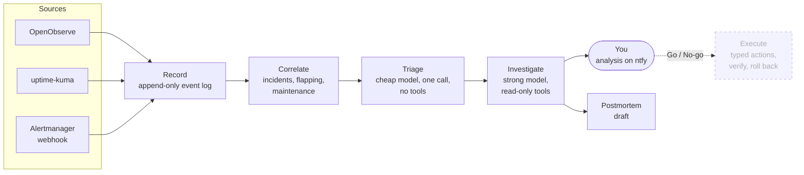

<div align="center">


### The on-call colleague for your self-hosted server

Alert triage, read-only investigation and (soon) approved remediation,<br>
with a hard line between what a model may **think** and what code may **do**.

[](https://github.com/mmornati/paeon/actions/workflows/ci.yml)
[](LICENSE)


[Quick start](#quick-start) · [How it works](#how-it-works) · [Safety](#safety-model) · [Privacy](#what-leaves-your-server) · [Roadmap](#roadmap) · [Design](docs/llm-incident-response-architecture.md)

</div>

---

It is 03:12. Your phone buzzes: `SLO fast burn`. Is it the nightly update again, or is the disk
really full this time?

**Paeon** (the healer of the gods in Homer) sits next to your alerting and answers that question
before you are awake enough to ask it. It listens to OpenObserve, uptime-kuma and anything that
speaks the Alertmanager webhook, groups alerts into incidents, asks a cheap model whether this is
noise, lets a strong model investigate with tools that can only read, and sends you what it found:
a root cause, the evidence for it, and a plan.

> [!IMPORTANT]
> **Paeon takes no action on your server today.** It records, correlates, triages, investigates
> and drafts postmortems. Executing a fix after your approval is the next phase. It is alpha
> software: run it next to your alerting, never instead of it.

## Why Paeon

- 🧠 **The model proposes, code disposes.** No shell, no free-form command, no write credential
  for a model, in any stage.
- 🔍 **Investigation with evidence.** Every claim in an analysis is tied to the tool call that
  supports it. A claim that cites no real call is marked as unverified.
- 🔒 **Allow-lists first, redaction second.** A log stream, a metric or a container that you did
  not list cannot be read, and what is read is scrubbed of secret-shaped strings before it leaves.
- 🧾 **Everything is an event.** One append-only SQLite log: every alert, decision, model call
  (with its cost) and tool result. Incidents, the digest and postmortems are derived from it.
- 💸 **Bounded by design.** Budgets per incident and per day, a storm guard per hour, limits on
  tool calls and time. A spent budget never hides an alert: Paeon fails open.
- 🔌 **Your models, your gateway.** Two clients, the Anthropic Messages API and the
  OpenAI-compatible chat API, each with a configurable base URL. Local servers work.
- 🪶 **Small.** One container, one SQLite file, one YAML file. No vector database, no queue.

## How it works



Solid boxes are built. The dashed one is the roadmap: a closed catalog of typed actions, applied
by plain code after a signed, single-use approval from your phone, with autonomy earned per action
and per target. The full reasoning is in the
[design document](docs/llm-incident-response-architecture.md).

## Quick start

You need Python 3.12 or later and [uv](https://docs.astral.sh/uv/).

```bash
git clone https://github.com/mmornati/paeon.git && cd paeon
```

```bash
cp .env.example .env    # set PAEON_INGEST_TOKEN, and the OpenObserve variables if you use it
```

```bash
uv sync && set -a && . ./.env && set +a && uv run paeon serve
```

Send it a first alert:

```bash
curl -X POST http://127.0.0.1:8080/ingest/alertmanager -H "Authorization: Bearer $PAEON_INGEST_TOKEN" -H 'Content-Type: application/json' -d '{"alerts": [{"status": "firing", "fingerprint": "demo-disk-full", "labels": {"alertname": "DiskFull", "severity": "warning", "instance": "server-1"}, "annotations": {"summary": "/ is 95 % full"}}]}'
```

Then read what it recorded:

```bash
uv run paeon incidents
```

Without a rules file Paeon correlates with its defaults and calls no model. Nothing leaves your
machine until you enable a stage.

### With Docker

[examples/compose.yaml](examples/compose.yaml) is a hardened deployment: read-only root
filesystem, no capabilities, non-root user, secrets as files, and a Docker socket proxy limited
to `GET` so that Paeon never holds the socket.

## Connect your alerts

| Source | How |
|---|---|
| **uptime-kuma** | Add a notification of type **Webhook**: post URL `http://paeon:8080/ingest/uptime-kuma`, body `application/json`, additional header `{"Authorization": "Bearer <PAEON_INGEST_TOKEN>"}`. Apply it to every monitor. |
| **Alertmanager, Grafana, others** | Point a webhook receiver at `http://paeon:8080/ingest/alertmanager` with the same bearer token. |
| **OpenObserve** | Create a user that can read the `triggers` stream and set the `PAEON_OPENOBSERVE_*` variables. Paeon polls; it never writes to OpenObserve and nothing changes in your alerts. |
| **Planned work** | Announce a deploy, an update run or a backup from the script that does it, so triage knows about it (below). |

```bash
curl -X POST http://paeon:8080/ingest/change -H "Authorization: Bearer $PAEON_INGEST_TOKEN" -H 'Content-Type: application/json' -d '{"kind": "update", "title": "weekly updater", "host": "server-1"}'
```

A pull source that stops answering opens an internal `source_stale` alert, and Paeon can push a
heartbeat to an uptime-kuma push monitor (`PAEON_HEARTBEAT_URL`), so a silent Paeon is noticed.

## Configure

Behaviour is one YAML file, named by `PAEON_CONFIG`: correlation windows, host rules, maintenance
windows, model aliases, triage, investigation, postmortems and the digest. Start from
[examples/paeon.yaml](examples/paeon.yaml). Every key is optional and **every stage is off until
you enable it**.

Secrets never go in that file. It names the environment variable that holds them (`api_key_env`,
`token_env`), and every secret also accepts `NAME_FILE=/path` for Docker secrets.

| Stage | What it does | Model |
|---|---|---|
| `triage` | One call per incident with a context pack built by code. Verdict: `noise`, `transient`, `known_issue` or `real`. **Shadow mode**: recorded and shown in the digest, nothing acts on it. Page-level alerts are never sent. | cheap |
| `investigation` | An agent loop with read-only tools and a budget. Hands in a summary, the impact, a root cause with a confidence, the evidence, the hypotheses it rejected and a plan for a person. | strong, with tool calls |
| `postmortems` | A markdown draft with YAML front matter once an investigated incident has stayed resolved. Timeline and automation review come from the event log; the model writes the prose; the file says `status: draft`. | strong |

The investigator's tools:

- **Paeon's own record**: open and past incidents, the change calendar, keyword search in your
  runbooks and past postmortems.
- **OpenObserve**: log search on an allow-list of streams, PromQL on an allow-list of metric names.
- **Docker**, through a socket proxy: list, inspect (without the environment), and logs for an
  allow-list of containers.

### Command line

| Command | |
|---|---|
| `paeon serve` | Run the service |
| `paeon incidents` | Incidents as JSON lines |
| `paeon events --kind alert.firing` | The event log as JSON lines |
| `paeon digest --hours 24` | The digest of the last hours |
| `paeon feedback <id> up\|down` | Say whether triage was right |

The same is available over HTTP behind the bearer token: `GET /incidents`, `GET /incidents/{id}`,
`POST /incidents/{id}/feedback`, `GET /digest`.

## What leaves your server

Nothing, until you enable a stage. Then, always to the model you configured and after redaction
of secret-shaped strings:

| Stage | Sent to the model |
|---|---|
| Triage | Alert titles, descriptions and labels. No raw payload, no log line. |
| Investigation | The same, plus what its tools return: rows of the log streams you listed, the metrics you listed, container state without the environment, log lines of the containers you listed, and excerpts of your runbooks and postmortems. |
| Postmortems | The incident's timeline and the investigation's findings. |

The allow-lists in `investigation.tools` are the control: a stream or a container that is not
listed cannot be read. Leave out anything that holds personal data. Give Paeon credentials that
can only read as well (an OpenObserve account limited to search, a Docker socket proxy limited to
`GET`), so that the allow-lists are the second net and not the only one.

Paeon itself has no telemetry and calls nothing but what you configure: your alert source, your
model endpoint, your ntfy topic and your heartbeat URL.

## Safety model

Paeon assumes that **alert text and log lines are written by an attacker** (a file name, a
User-Agent, a hostname from DHCP) and that **the model will eventually be wrong**.

- The model's output is advice. In the current phases nothing can act on it.
- Tools only read, each behind an allow-list, with results bounded, redacted and recorded in full.
- Triage fails open: a model that is down, an invalid answer, low confidence or a spent budget all
  mean "treat as real".
- Paeon never sits in the path of your alerts. Your existing notifications stay as they are.
- The API has a bearer token and nothing else. **Keep it on an internal network.**

More in [SECURITY.md](SECURITY.md), including how to report a vulnerability, and in
[§4 of the design](docs/llm-incident-response-architecture.md#4-safety-model).

## Roadmap

| Phase | What | State |
|---|---|---|
| 0. Record | Alert schema, append-only event log, OpenObserve pull adapter, webhooks, source staleness, heartbeat | ✅ built |
| 1. Observe | Correlation into incidents, flap and maintenance flags, change calendar, triage in shadow mode, daily digest with feedback | ✅ built |
| 2. Investigate | Read-only investigation by a strong model, analysis by notification, postmortem drafts | ✅ built, see the limits below |
| 3. Approve and act | Action catalog, signed Go / No-go, executor, verification, rollback | planned |
| 4. UI and MCP | Incident pages, autonomy matrix | planned |
| 5. Earned autonomy | Promotion proposals, `auto` for the first actions, Undo | planned |
| 6. Release | Docs, threat model, a stranger running it against Prometheus and Docker in under an hour | in progress |

<details>
<summary><strong>Limits as built</strong></summary>

- The investigator cannot re-run an alert's own query: that needs the alert definition from
  OpenObserve, an open question of the design. It can search the streams you allow.
- There is no tool for uptime-kuma monitor history, for git history or for hosts reached over
  SSH: the investigator sees other machines only through their logs and metrics.
- Knowledge search is a keyword scan of markdown files, not an index.
- Postmortem drafts are files in a directory. Committing them to a git repository is left to
  whatever syncs that directory; Paeon holds no git credential.
- The plan in an analysis is free text for a person. The typed action catalog is phase 3.
- A model that declines a request ends the investigation as failed; no fallback model is tried.
- Triage does not yet read past postmortems, and feedback is given from the CLI or the API (the
  notifications have no buttons).

</details>

<details>
<summary><strong>What is in the box, module by module</strong></summary>

- **Alert schema** (`paeon.schema.Alert`): one normalized observation, modelled on the
  Alertmanager webhook.
- **Event log** (`paeon.store`): SQLite, append-only (enforced by triggers). Every decision is an
  event; incidents are a projection of it.
- **Recorder** (`paeon.recorder`): turns repeated observations into state changes, so an alert
  that is evaluated every five minutes for two hours is one `alert.firing` and one
  `alert.resolved`.
- **Sources** (`paeon.sources`): the OpenObserve pull adapter and the webhook endpoints.
- **Correlation** (`paeon.correlation`): the same alert firing again within a window is the same
  incident; alerts on the same host within a few minutes join the open incident. Flapping and
  maintenance windows are flags on the incident. Nothing is dropped.
- **Triage** (`paeon.triage`), **investigation** (`paeon.investigation`, `paeon.tools`) and
  **postmortems** (`paeon.postmortem`): the three model stages.
- **Model clients** (`paeon.models`): the Anthropic Messages API (through the `anthropic` SDK)
  and the OpenAI-compatible chat API, both with tool calls.
- **Redaction** (`paeon.redact`): the scrub applied before anything reaches a model.
- **Digest and feedback** (`paeon.digest`): `paeon digest`, `GET /digest`, and optionally one
  ntfy message a day.

</details>

## Contributing

Issues and pull requests are welcome; read [CONTRIBUTING.md](CONTRIBUTING.md) first, and the
[code of conduct](CODE_OF_CONDUCT.md). The checks CI runs:

```bash
uv run ruff check && uv run ruff format --check && uv run mypy && uv run pytest --cov
```

## A word on cost and trust

Paeon calls paid model APIs on your behalf when you enable a stage. Set the budgets in the rules
file before you point it at a noisy alert source. Its analysis is written by a language model: it
can be confidently wrong. Read the evidence, not only the conclusion.

## Licence

[Apache-2.0](LICENSE). Paeon is an independent project, not affiliated with or endorsed by
OpenObserve, uptime-kuma, Prometheus, Docker, ntfy, Anthropic or OpenAI; those names belong to
their owners.
