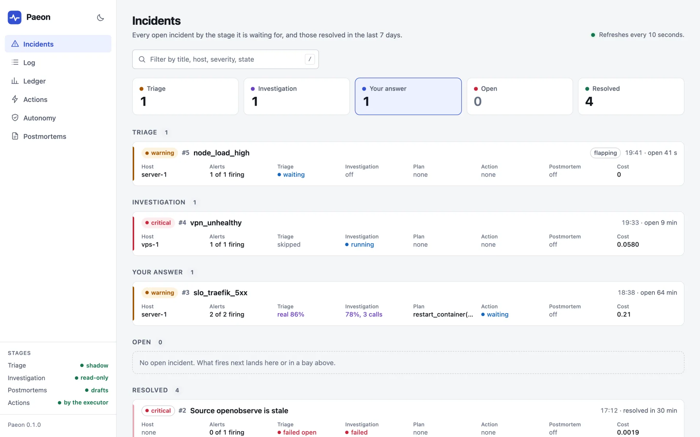
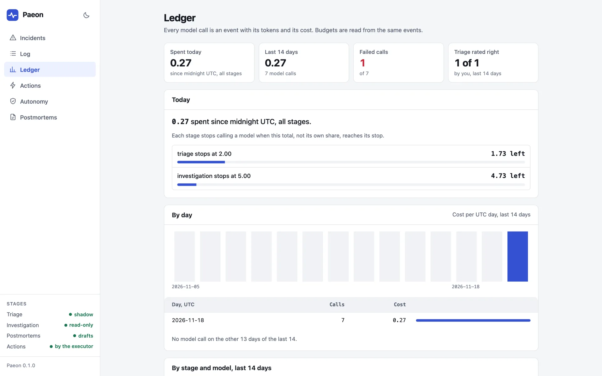

# The console

The console is the event log rendered for a person, under `/ui`. It is where you see why Paeon
said what it said: what was taken into account, which model or tool was called, what it cost,
and what was sent or done.



Every screenshot on this page comes from synthetic data (`tests/ui_data.py`): no real server,
alert or model answer is shown.

## Turn it on

```yaml
ui:
  enabled: true
  require_header: X-authentik-username   # optional
  proxy_secret: {}                       # optional, recommended: see below
```

Then open `http://paeon:8080/ui`.

!!! warning "By default the console has no login"

    It is off until you enable it, and unless you set `auth: local` (below) it must sit behind
    a reverse proxy that authenticates (Traefik with Authentik forward-auth, for example): route
    `/ui` through it and do not publish Paeon's port. `require_header` names a header your proxy sets once the user is authenticated;
    a request without it is refused. That is a second net against a route that bypasses the
    proxy, not a login: anyone who can reach the port directly can send the header. The ingest
    endpoints keep their bearer token either way.

### A secret only the proxy knows

The proxy's network is usually shared: every container on it can reach Paeon's port and send
any header. `proxy_secret` closes that. Put a long random value in `PAEON_UI_PROXY_SECRET`
(24 characters or more) and have the proxy add it to each request as `X-Paeon-Proxy`; a request
without that exact value is refused. Both names can be changed (`header`, `value_env`).

With Traefik, a second middleware after the one that authenticates:

```yaml
http:
  middlewares:
    paeon-proxy-secret:
      headers:
        customRequestHeaders:
          X-Paeon-Proxy: "the same value as PAEON_UI_PROXY_SECRET"
  routers:
    paeon:
      middlewares: [authentik@file, paeon-proxy-secret]
```

### Without a proxy: one password

For a server with no authenticating proxy, the console can ask for a password itself:

```yaml
ui:
  enabled: true
  auth: local
```

Set `PAEON_UI_ADMIN_PASSWORD` (12 characters or more) and `PAEON_SECRET_KEY` (32 or more, any
long random value). Whoever signs in is the admin. The session is a signed cookie that lasts 14
days; changing the password or the key signs everyone out. After five wrong passwords in a row
from one address, no password from that address is looked at for a minute; after fifty
in a row from anywhere, none is for anyone. There is one account and no user list: for several
people, use a proxy and roles. Serve it over TLS as soon as it leaves your own network.

### Roles

Behind a proxy, `roles` says who may do what, from the groups the proxy names for each request:

```yaml
ui:
  enabled: true
  proxy_secret: {}
  roles:
    header: X-authentik-groups     # the default; Authelia: Remote-Groups, separator ","
    admin: [paeon-admins]
    operator: [paeon-operators]
```

| Role | Can |
|---|---|
| viewer | Read every page. Anyone the proxy lets in who is in no listed group. |
| operator | Also say whether triage was right, and stop automation. |
| admin | Also add, change, test and remove channels, when `settings` is on. |

`roles` needs `proxy_secret`: a groups header anyone on the network can send would prove
nothing. Without `roles`, everyone the proxy lets in is an operator, as in earlier versions,
and nobody is an admin.

## Channels in the console

```yaml
ui:
  enabled: true
  auth: local        # or roles with an admin group
  settings: true
```

With `settings` on, an admin adds notification channels on the Channels page: choose the
service, name the channel, fill in its settings, choose what it carries, and send a test.
A channel added there takes effect at once, without a restart. This also needs
`PAEON_SECRET_KEY`.

- **The rules file stays the source for what it defines.** The console never writes it. Its
  channels are shown marked `rules file` and can be tested from the console, not changed. A
  name the file defines cannot be taken in the console; if the file later claims a name the
  console used, the console's channel is set aside and the page says so.
- **Console channels live in the database**, next to the event log. A secret typed in the
  browser is encrypted with `PAEON_SECRET_KEY` before it is stored, is never shown again, and
  is deleted with its channel. Changing where a channel sends (its server, host or port)
  asks for its secrets again: a stored secret is never sent to a new address. Lose the key and those channels are set aside until you save
  them again with their secrets. Back up the database and keep the key somewhere else.
- **They carry the digest and the analysis, never an approval.** Approvals are sent by the
  executor, from its own copy of the rules file, next to the key that signs them.
- **The log says who changed what**: the service, what the channel carries and who saved it.
  It holds neither an address nor a secret.
- **With `settings` off, the file is all there is**: channels added in the console are kept and
  ignored. That is the setting for a deployment configured from git.

## The pages

| Page | |
|---|---|
| **Incidents** | Every open incident and those resolved in the last 7 days, grouped by the stage they are waiting for: triage, investigation, your Go (with actions on), open, resolved, with a count of each at the top and a filter box. It refreshes itself; an incident that changed is marked until you touch it. |
| **Incident** | The alerts, what triage said and whether you agreed, the investigation's findings with each claim tied to the tool call behind it, the plan and what became of it, and the full record of events with their payloads. |
| **Log** | Everything recorded, filtered by who spoke: came in, decided by code, said by a model, read by a tool, left the server. |
| **Ledger** | The cost of model calls by day, stage and model, against the daily budgets. |
| **Sources** | Every monitoring service: how its alerts arrive (with the address it posts to), the tools it offers an investigation, how many alerts it fired in the last 30 days, and whether a polled one has gone stale. Never its address or its secret. |
| **Channels** | Every notification channel a stage sends to, what it carries, and how its deliveries of the last 30 days went. Shown once a channel is configured. |
| **Actions** | The kill switch, the plans waiting for your answer, every plan of the last 30 days with its outcome, the catalog and the policies. |
| **Autonomy** | Per alert, action and container: the level in force, the track record, what was demoted and why, and the promotions that were earned, as the line to add to your rules file. |
| **Postmortems** | The drafts, their review status and their open action items. A draft is shown rendered (headings, tables, ticked action items), with its markdown source one click away; the file itself stays markdown. A `mermaid` block is drawn as a diagram. |

## An incident, top to bottom

The header says where the incident stands: severity, status, and one box per stage.


The investigation shows the model's summary, the impact and the root cause with its confidence.
Each claim under **Evidence** links to the tool call behind it. A claim that cites no real call
says so.


With actions on, the plan says what was proposed, at which level, and what became of it. While
it waits, the console tells you where the Go is: on your phone.


Once you answered and the executor ran it, the same section says so, and every step is in the
record below it.


## What it costs

The ledger shows what the model calls cost, by day, stage and model, against the daily budgets.



## Postmortems

A draft is shown rendered, with its markdown source one click away. A `mermaid` block is drawn
as a diagram.


## On a phone, in the dark

The console is built phone first, since that is where a notification opens it, and follows your
system's light or dark setting unless you use the switch.

<div class="shots" markdown>
{ width="300" }
{ width="300" }
</div>

## What it can and cannot do

What a model said is shown in violet and marked as the model's, what code recorded in plain text:
a verdict is never dressed as a fact. Light or dark follows your system, or the switch you set.

The console reads, apart from three things: an operator says whether triage was right and
stops automation, and with `settings` on an admin manages the channels the digest and the
analysis go to. **It cannot approve a plan**, it cannot resume what it stopped, and nothing it
configures can carry an approval.

Everything shown is redacted again first, and pages load nothing from another host.
