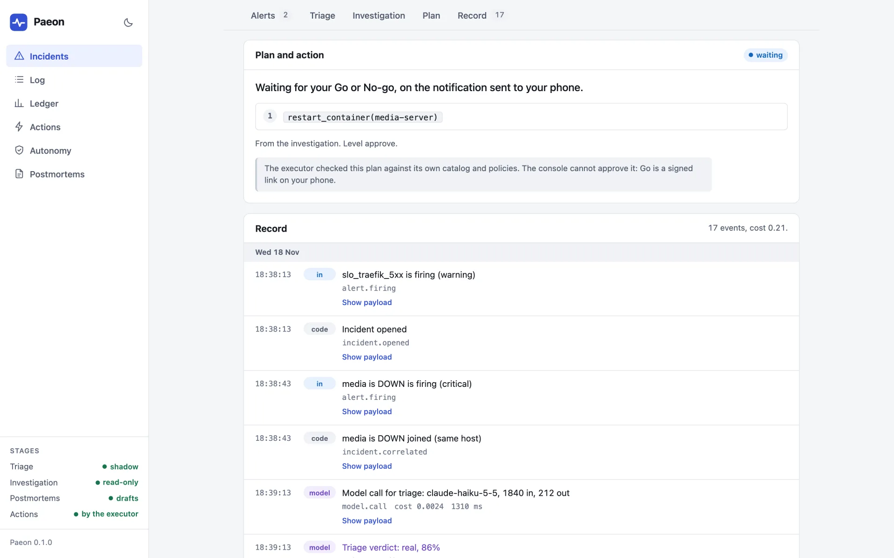
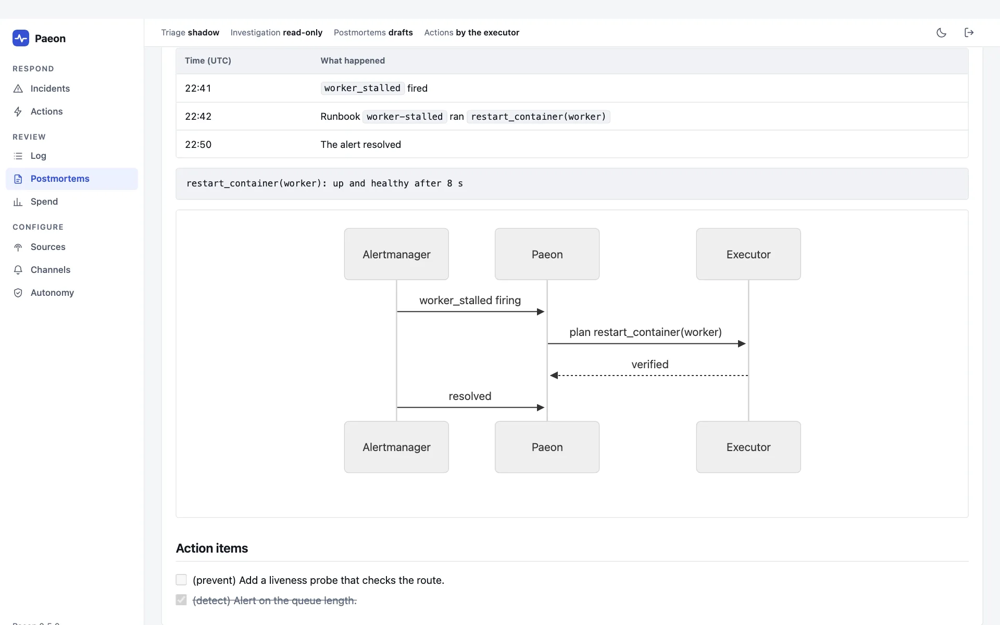
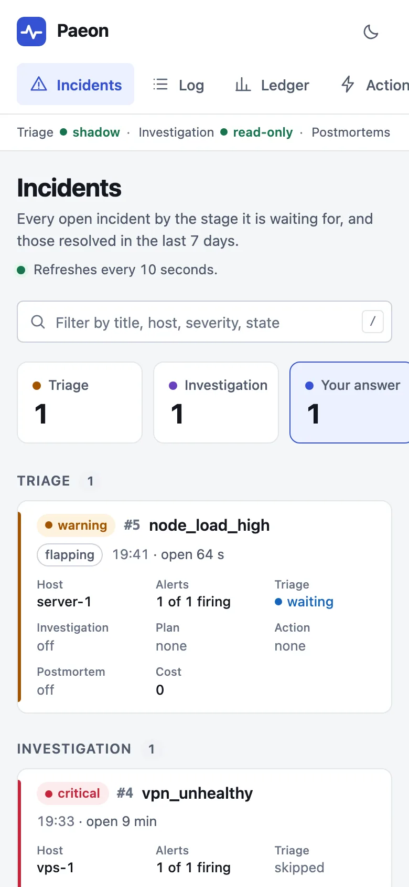
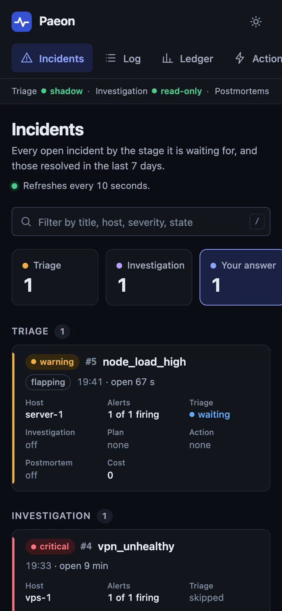

# The console

The console is the event log rendered for a person, under `/ui`. It is where you see why Paeon
said what it said: what was taken into account, which model or tool was called, what it cost,
and what was sent or done.


Every screenshot on this page comes from synthetic data (`tests/ui_data.py`): no real server,
alert or model answer is shown.

## Turn it on

```yaml
ui:
  enabled: true
  require_header: X-authentik-username   # optional
  proxy_secret: {}                       # optional, recommended: see below
```

Then open `http://paeon:8080/ui`.

!!! warning "The console has no login"

    It is off until you enable it, and it must sit behind a reverse proxy that authenticates
    (Traefik with Authentik forward-auth, for example): route `/ui` through it and do not publish
    Paeon's port. `require_header` names a header your proxy sets once the user is authenticated;
    a request without it is refused. That is a second net against a route that bypasses the
    proxy, not a login: anyone who can reach the port directly can send the header. The ingest
    endpoints keep their bearer token either way.

### A secret only the proxy knows

The proxy's network is usually shared: every container on it can reach Paeon's port and send
any header. `proxy_secret` closes that. Put a long random value in `PAEON_UI_PROXY_SECRET`
(24 characters or more) and have the proxy add it to each request as `X-Paeon-Proxy`; a request
without that exact value is refused. Both names can be changed (`header`, `value_env`).

With Traefik, a second middleware after the one that authenticates:

```yaml
http:
  middlewares:
    paeon-proxy-secret:
      headers:
        customRequestHeaders:
          X-Paeon-Proxy: "the same value as PAEON_UI_PROXY_SECRET"
  routers:
    paeon:
      middlewares: [authentik@file, paeon-proxy-secret]
```

## The pages

| Page | |
|---|---|
| **Incidents** | Every open incident and those resolved in the last 7 days, grouped by the stage they are waiting for: triage, investigation, your Go (with actions on), open, resolved, with a count of each at the top and a filter box. It refreshes itself; an incident that changed is marked until you touch it. |
| **Incident** | The alerts, what triage said and whether you agreed, the investigation's findings with each claim tied to the tool call behind it, the plan and what became of it, and the full record of events with their payloads. |
| **Log** | Everything recorded, filtered by who spoke: came in, decided by code, said by a model, read by a tool, left the server. |
| **Ledger** | The cost of model calls by day, stage and model, against the daily budgets. |
| **Actions** | The kill switch, the plans waiting for your answer, every plan of the last 30 days with its outcome, the catalog and the policies. |
| **Autonomy** | Per alert, action and container: the level in force, the track record, what was demoted and why, and the promotions that were earned, as the line to add to your rules file. |
| **Postmortems** | The drafts, their review status and their open action items. A draft is shown rendered (headings, tables, ticked action items), with its markdown source one click away; the file itself stays markdown. A `mermaid` block is drawn as a diagram. |

## An incident, top to bottom

The header says where the incident stands: severity, status, and one box per stage.


The investigation shows the model's summary, the impact and the root cause with its confidence.
Each claim under **Evidence** links to the tool call behind it. A claim that cites no real call
says so.


With actions on, the plan says what was proposed, at which level, and what became of it. While
it waits, the console tells you where the Go is: on your phone.



Once you answered and the executor ran it, the same section says so, and every step is in the
record below it.


## What it costs

The ledger shows what the model calls cost, by day, stage and model, against the daily budgets.


## Postmortems

A draft is shown rendered, with its markdown source one click away. A `mermaid` block is drawn
as a diagram.



## On a phone, in the dark

The console is built phone first, since that is where a notification opens it, and follows your
system's light or dark setting unless you use the switch.

<div class="shots" markdown>
{ width="300" }
{ width="300" }
</div>

## What it can and cannot do

What a model said is shown in violet and marked as the model's, what code recorded in plain text:
a verdict is never dressed as a fact. Light or dark follows your system, or the switch you set.

The console is read-only, apart from two things: saying whether triage was right, and
stopping automation. **It cannot approve a plan**, and it cannot resume what it stopped.

Everything shown is redacted again first, and pages load nothing from another host.
