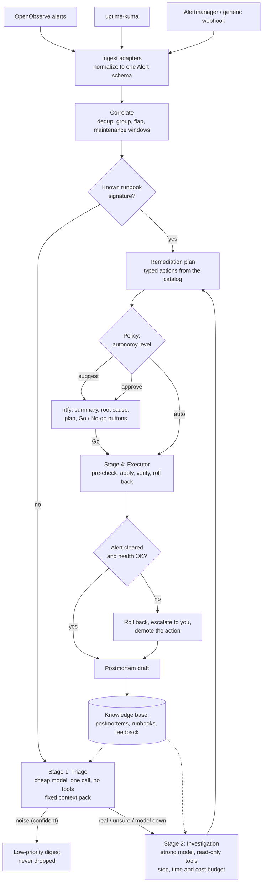
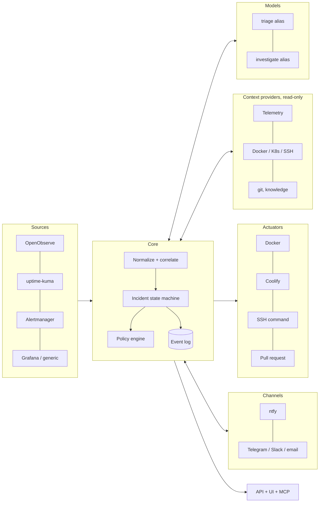

# LLM incident response: architecture draft

Status: design reviewed on 2026-11-18. Every phase of §9 is built in this repository, with the
limits listed in the README. Phases 3 and 5 (acting, earned autonomy) are written and tested, and
have not yet met their exit criteria, which are about use on a real server. Where what was built
differs from this text, §11 says how.
Name: **Paeon** (the healer of the gods in Homer).
Decisions, the review changes and what is still open are in §10.

The design was written against one reference deployment: a single self-hosted Docker host whose configuration
lives in its own git repository ("the deployment repo" below). Where the text says "here" or "this server" it
means that deployment; the project itself ships examples only.

## 1. Recommendation in short

- **Build it as a dedicated open-source project**, not inside the deployment repo and not as a Horae plugin.
  The deployment repo keeps only the deployment (a compose file) and the configuration (routes, runbooks,
  policies).
- **Four stages with a hard boundary between "thinking" and "doing"**: triage (cheap model, one call, no tools),
  investigation (strong model, read-only tools), approval (you, on the phone), execution (plain code, a closed
  catalog of typed actions). The model never holds a shell or a write credential.
- **Autonomy is earned per action and per target**, never switched on globally: observe → suggest → approve →
  auto-then-notify, promoted on evidence from past incidents and demoted automatically on a failure.
- **Everything is an append-only event log** from which the timeline, the postmortem, the UI and the metrics are
  derived.
- **Horae is a consumer and a pattern donor, not the host**: Paeon reuses Horae's safety ideas (intents applied by a
  core, dry run, journal, signed single-use action links) and Horae reads Paeon's incidents and postmortems into the
  daily brief and the vault.

## 2. What exists today and what it implies

| Fact (from the reference deployment) | Consequence for the design |
|---|---|
| Two alert sources: OpenObserve (SLO burn rates, service, storage, CPU and network alerts) and uptime-kuma (HTTP checks and push monitors). Both end in ntfy topics. | Two source adapters from day one; ntfy stays the phone channel. |
| OpenObserve alerts post ntfy JSON to HTTP destinations, and its SSRF guard refuses private addresses. | One more destination pointing at `http://paeon:8080` would be refused too. |
| OpenObserve logs every alert **evaluation** (one row per alert every 5 minutes, not one per state change) in its `triggers` stream: `key` (`<alert_name>/<alert_id>`), `status`, start and end time. In a nine-day sample with `module = 'alert'`, `normal` rows outnumbered `firing` rows by about 500 to 1, and one flapping SLO alert produced more than half of the `firing` rows. | Paeon can **pull** firings and recoveries over the internal network with one SQL query, with no change in OpenObserve, but the adapter must turn evaluation rows into state changes (§3, stage 0). That one alert is the first triage test case. |
| A watchdog script already does graduated auto-repair of one service (soft fix → restart the service → restart what it depends on) with a dry-run mode and ntfy. | It is the first runbook to migrate, and proof that the tiered approach works. |
| Past incidents were multi-cause and non-obvious: Docker address pools exhausted, an OpenObserve memtable deadlock, compose alias loss after an update, dockerd at 375 % from corrupt logs after a power cut. | A restart-only bot would have fixed none of them. The investigation stage and the knowledge base are where the value is. |
| The weekly and nightly update batches cause expected blips; the updater can report green when pulls were rate limited. | Triage needs a "change calendar" (update runs, deploys, backups) as context. |
| Monitoring and its watchers run on the host they watch. | Paeon cannot fix a dead host. It must push a heartbeat to uptime-kuma and never be the only path an alert takes. |
| Some log streams hold sensitive content (shell or assistant transcripts, personal applications). | A per-stream allow-list and redaction before anything reaches a model. |
| A model gateway is available that speaks both the OpenAI and the Anthropic API, picks the cheapest good-enough model per prompt, and has a secrets / PII pre-check, budgets and a decision log. | The natural model gateway for triage (§8). Paeon itself only needs the two API dialects. |

## 3. Pipeline



### Stage 0: ingest and correlate (no model)

- **Alert schema** (the project's public contract): `source`, `fingerprint`, `status` (firing / resolved), `severity`,
  `title`, `description`, `labels` (host, service, container, stream), `starts_at`, `source_url`, `query` (what fired),
  `raw`. Modelled on the Alertmanager webhook payload so that anything speaking it works unchanged.
- **Two kinds of source adapter**, both producing the same schema:
  - *pull*: the adapter polls the source. **OpenObserve uses this**: every 30 to 60 s,
    `SELECT … FROM "triggers" WHERE module = 'alert' AND status != 'normal'` plus the latest row per key, since the
    last cursor, then the alert's definition (query, description, thresholds) by id from the alerts API.
    Nothing changes in OpenObserve, the existing ntfy destinations stay untouched, it works while the internet
    link is down, and a restart of Paeon loses nothing (it resumes from its cursor).
    - **Rows are levels, the schema wants edges.** A state is kept per key: the first `firing` or
      `notify_failed` row opens the alert, later ones keep it open, the first `normal` row closes it. Only the two
      transitions become Alert events; the rows in between update `last_seen`. `skipped` rows say nothing about
      the condition (their meaning is unconfirmed, and they also occur while an alert is not firing), so they
      change nothing. The stream contains exact duplicate rows, which the same rule absorbs. The reduction lives
      in the core, not in the adapter, so a resent uptime-kuma DOWN is handled the same way.
    - **`notify_failed` counts as firing.** It means the alert fired and OpenObserve could not deliver it, which is
      the case where Paeon's own notification matters most.
    - **Cursor with overlap.** Rows can be ingested late, so each poll re-reads the last few minutes and
      deduplicates on (key, `_timestamp`) instead of trusting a strict "greater than the cursor".
    - The `triggers` rows carry no result rows, so Paeon re-runs the alert's query for the context pack.
    - `module = 'slo'` rows have other statuses (`succeeded`, `notify_failed`) and numeric keys; the burn-rate
      alerts seen so far (`slo_fast_burn_…`) arrive under `module = 'alert'`. Whether the `slo` module carries
      anything the `alert` module does not is a phase 0 spike question; until answered it is recorded, not acted on.
    - (`GET /alerts/history` answers 404 on this instance, hence SQL on the stream.)
  - *push*: a webhook endpoint with a bearer token, for uptime-kuma (native webhook notification, same Docker network),
    Alertmanager and anything else. Other OpenObserve users can add Paeon as one more destination on their alerts,
    the mechanism the ntfy notifications use here.
- **Correlation** turns alerts into **incidents**: same fingerprint within a window is one incident; alerts on the same
  host within a few minutes attach to the open incident (a Traefik outage fires ten Kuma monitors and three SLOs; that
  is one incident and one model run, not thirteen).
- **Deterministic filters first**: flapping detection, declared maintenance windows, the change calendar. Cheap, exact,
  and they cut model spend.
- **Storm guard**: at most N investigations per hour and one per incident; beyond that, the raw alerts pass through
  untouched with a "storm, automation paused" note.
- **Source staleness is an alert of its own.** A pull source that cannot be polled, or returns no evaluation rows at
  all for longer than a few intervals, opens an internal `source_stale` incident. In the reference deployment Paeon learns
  about OpenObserve's alerts from OpenObserve, so an OpenObserve outage (it has happened: the memtable deadlock)
  would otherwise look like a quiet day.

### Stage 1: triage (cheap model, bounded)

One call, no tools, JSON output validated against a schema (the shape of Horae's `llm` step). Its input is a
**context pack built by code**, the same for every alert of a class:

- the alert, its last 30 days of firings and how each ended;
- the metric or log query that fired, re-run over a wider window;
- the change calendar for the last 2 h (updater runs, deploys, container restarts, backups);
- current state of related monitors in uptime-kuma;
- the top 3 past postmortems with the same fingerprint or service.

Output: `verdict` (noise / transient / known_issue / real), `confidence`, `severity`, `reason`, `matched_postmortem`.

Rules that keep it safe:

- **Fail open.** Model unreachable, invalid output twice, or confidence below the threshold → treat as real.
- **Noise is demoted, never deleted**: it goes to a daily digest with 👍 / 👎 buttons, which is also the labelled data
  that tells you whether triage can be trusted.
- **Page-level alerts skip triage** (priority 5: `vpn_unhealthy`, fast burn). They go to investigation directly while
  the original ntfy page still reaches you as today.

### Stage 2: investigation (strong model, read-only agent loop)

This is the only agent loop in the system. The model gets **read-only tools** and a budget (for example 25 tool calls,
10 minutes, a cost cap per incident and per day):

| Tool family | Examples | Backed by |
|---|---|---|
| Telemetry | SQL on log streams, PromQL range queries, SLO status | OpenObserve (its MCP server or API, a read-only account) |
| Runtime | `ps`, `inspect`, `logs --tail`, `stats`, networks, disk usage | Docker through `dockerproxy` limited to GET; SSH with a forced read-only command for other hosts |
| Monitors | monitor state and history | uptime-kuma |
| Changes | recent commits, last updater and backup runs, Coolify deployment list | git, updater logs |
| Knowledge | search postmortems and runbooks, the deployment repo's README | SQLite FTS over markdown (no vector database needed at this size) |

Output, schema-validated: `summary`, `impact`, `root_cause` with a confidence, **`evidence`** (each claim linked to the
tool call that supports it), `hypotheses_rejected`, and a `plan`: an ordered list of actions **chosen from the catalog**,
each with parameters, expected effect, a verification check and a rollback. "No safe automated fix; here is what I
would do by hand" is a valid plan.

### Stage 3: approval

- ntfy message on a dedicated topic (`incidents`): three lines of what and why, the plan in plain words, and buttons
  **Go**, **No-go**, **Details** (the incident page).
- Buttons are **signed, single-use, expiring links** bound to the exact plan hash (Horae's `/act/` design, reusable
  almost as is). If the plan changes, or the alert resolves before you answer, old links are dead.
- Approval strength follows the action tier (§4):
  - tier 1: one tap. The Go button is an ntfy `http` action that `POST`s the signed link straight from the phone.
    A plain `GET` of the same link (a preview fetch, a crawler, a mis-tap in the browser) only shows a confirmation
    page and never applies.
  - tier 2: the button only opens the incident page, and the approval is given there behind single sign-on.
- A one-tap approval is as strong as the notification channel: the `incidents` topic must require an ntfy token
  with read access limited to you, and the approval endpoint is the only Paeon path reachable without single sign-on.
- No answer within the window → nothing happens, the incident stays open, one reminder.

### Stage 4: execution and verification (no model)

The executor is deterministic code in a **separate container with its own credentials**. For each action:
pre-check (is the world still as the plan assumed?) → snapshot what is needed to roll back → apply → wait → verify
(the action's health check first, then the alert's own query; a burn-rate alert can take an hour to clear, so the
health check decides and the alert is followed up later) → on failure roll back where the action defines a rollback,
and stop the plan. One automated attempt per incident; a second failure always goes to a human.

- **The executor does not trust the core.** The core reads attacker-controlled text and talks to the model, so it is
  the component most likely to be subverted. The executor therefore re-validates everything itself: the plan against
  its own copy of the catalog and target allow-lists, and the approval (the signed link's token for `approve`, the
  policy file from git for `auto`). A request from the core without a valid approval for that exact plan hash is
  refused. The signing key for approvals lives with the approval endpoint and the executor, not with the
  investigation loop.
- **One writer per target.** A lock per container, shared with whatever else repairs it (the existing watchdog script until it is
  migrated, the updater), so two automations never restart the same thing at the same time.

## 4. Safety model

The design assumption is that **alert text and log lines are attacker-controlled** (a file name, a User-Agent in
the reverse-proxy log, a device hostname from DHCP) and that the model will eventually be wrong.

1. **The model proposes; code disposes.** No shell tool, no free-form command, in any stage. A plan is data that
   names catalog actions; unknown actions or parameters outside the allow-list are rejected before you ever see them.
2. **Action catalog with tiers:**

   | Tier | Kind | Examples | Highest autonomy it can earn |
   |---|---|---|---|
   | 0 | Read-only | every investigation tool | always automatic |
   | 1 | Reversible, small blast radius | restart a container, resume a paused job, reattach a network alias, Coolify redeploy of the same version, rotate a log | auto-then-notify |
   | 2 | Changes configuration or state | edit a compose value, prune images, truncate a corrupt log, change a limit | approve, as a **pull request on the deployment repo** when it touches config |
   | 3 | Destructive or security-relevant | delete data or volumes, firewall, DNS, secrets, the identity provider, host reboot, anything on the router | never; the plan may only describe it for you to do |

3. **Least privilege by construction**: the investigator's credentials can only read; the executor exposes only the
   catalog; Docker goes through a socket proxy with an endpoint allow-list; per-target allow-lists (for example, restart
   is allowed on application containers, not on the identity provider, the tunnel, the reverse proxy or OpenObserve itself without approval).
4. **Data hygiene before any model call**: stream allow-list (never transcripts or personal data), secret-pattern
   redaction, truncation, and tool results wrapped as untrusted data. The same allow-list applies to the runtime
   tools, or it is trivially bypassed: `docker logs` only for allowed containers (private applications log
   the content their streams are excluded for), and `docker inspect` returns a projection without `Env`, labels
   holding credentials and mount sources outside an allow-list (the environment is where every secret of the
   server sits).
5. **Budgets and breakers**: cost caps per incident and per day, rate limits, one auto attempt per incident, a global
   kill switch (ntfy button, environment variable and UI) that drops the system to "observe" mode.
6. **It must never make alerting worse**: the existing OpenObserve → ntfy and uptime-kuma → ntfy paths stay as they
   are. Paeon adds a follow-up message; it replaces raw alerts for a class only after triage has proved itself on it.
7. **Watch the watcher**: heartbeat push monitor in uptime-kuma, its own traces and metrics in OpenObserve.

## 5. Earned autonomy

Policy is evaluated per **(alert class, action, target)**, stored in git, with four levels:

| Level | Behaviour |
|---|---|
| `observe` | triage and investigate silently; record what it would have done (shadow mode) |
| `suggest` | send the analysis; no buttons |
| `approve` | send the analysis and wait for Go / No-go |
| `auto` | execute, verify, then notify with an **Undo** button where the action has an inverse, and always a **This was wrong** button |

- **Promotion is proposed by the system and decided by you.** Example rule: after 5 approved executions of the same
  runbook signature, all verified, none rolled back, none edited by you, within 90 days, the postmortem ends with
  "propose `auto` for restart(worker) on `worker_stalled`" as a one-line config change (a PR).
- **Demotion is automatic**: one failed verification, one Undo or one "This was wrong" sends the tuple back to
  `approve`. (A restart cannot be undone, so Undo alone would leave the most common action without a demotion signal.)
- `auto` never applies when the incident has more than one correlated alert class, when investigation confidence is
  below the threshold, or outside tier 1.
- Successful investigations are distilled into **runbooks** (signature → checks → action). A runbook hit skips both
  models, which makes the frequent cases fast, free and deterministic. The existing watchdog script becomes runbook number one.

## 6. History, postmortems and learning

**Event log.** Every step appends an immutable event to the incident: alert received, correlation decision, each model
call (model actually used, prompt hash, tokens, cost, output), each tool call with its **full redacted result**
(replay in the learning loop below needs the content, not a digest), the plan, the approval (who, when, from which
link), each action with pre-check and verification, feedback. SQLite to start (single file, easy to back up),
exported as OpenTelemetry traces to OpenObserve so the responder has its own dashboard. The log holds log excerpts
from the server, so it gets a retention period for tool results and is never exported whole.

**Postmortems.** Written as markdown with YAML front matter into a git repository (the durable, portable form), drafted
by the strong model from the event log and marked `draft` until you review. The template combines the Google SRE
blameless postmortem, PagerDuty's and Atlassian's, plus two sections specific to automated response:

```markdown
---
id: 2026-11-18-worker-stalled
status: draft | reviewed
severity: SEV3
services: [worker, vpn]
hosts: [server-1]
alert_fingerprints: [...]
detected_at: ...   acknowledged_at: ...   mitigated_at: ...   resolved_at: ...
metrics: { ttd_min: 4, tta_min: 2, ttm_min: 9, ttr_min: 9 }
autonomy: approve        # level in force
llm_cost_usd: 0.31
---
# <Title: what broke, in user terms>

## Summary              (3 or 4 sentences: what happened, impact, cause, fix)
## Impact               (who or what was affected, for how long, data loss, SLO budget burned)
## Timeline             (generated from the event log; UTC and local)
## Detection            (which alert, how long after the start, what should have caught it sooner)
## Root cause           (the mechanism, with evidence links)
## Trigger              (the event that set it off: update, power cut, quota)
## Contributing factors (why it was possible or lasted; "five whys" where useful)
## Resolution           (what was done, by whom or what, and how recovery was verified)
## What went well / What went badly / Where we got lucky
## Automation review
   - Triage verdict and confidence; was it right?
   - Investigation: correct root cause at first attempt? Rejected hypotheses? Human corrections?
   - Actions: proposed vs approved vs executed; rollback?
   - Could this be handled at a higher autonomy level next time? Proposed policy or runbook change.
## Action items         (prevent / detect / mitigate; owner; issue link; due date)
## Lessons learned
## Appendix             (queries, graphs, raw alert payloads, model and prompt versions)
```

**Learning loop**, in increasing order of risk:

1. Retrieval: past postmortems and runbooks feed triage and investigation.
2. Feedback: 👍 / 👎 on triage and on root cause, stored as events.
3. **Replay as regression tests**: every closed incident (alerts plus recorded tool results) becomes a golden case;
   a prompt or model change must not get worse on the corpus before it is deployed (the idea behind `horae eval` and
   `horae replay`).
4. Runbook extraction and autonomy promotion proposals (§5).

No fine-tuning and no self-modifying prompts: every change in behaviour is a reviewed change in git.

## 7. Horae integration

Horae's core rules are "pipelines, not agent loops", one `llm` step with **no tools**, cron triggers only, and a closed
intent set (`note.*`, `task.*`, `notify.push`, `http.post`). Stage 2 needs a tool loop, stage 0 needs event triggers and
stage 4 needs infrastructure actions, so hosting this inside Horae would break the properties that make Horae
predictable. They should stay two projects with a narrow, one-directional link:

| Direction | Integration |
|---|---|
| Paeon → Horae (pull) | A Horae **source plugin** `paeon` reads Paeon's read-only API: open incidents, pending approvals, postmortems awaiting review, overdue action items. The daily brief shows them. |
| Paeon → vault | The same pipeline turns postmortem action items into `task.create` intents and writes a postmortem summary note (`note.create`), so follow-ups live with your other tasks. |
| Shared patterns | Signed action links, intents applied by a core with dry run and journal, model aliases and backends, budgets, de-identification, untrusted-content guards, SQLite store, MCP as plugin protocol. Worth extracting the link signing and the model backends into a small shared library later, once both projects are stable. |
| Shared infrastructure | Same ntfy server (separate topic and user), same single sign-on middleware with only the approval path exempt. |
| Not linked | Approvals and incident notifications do **not** pass through Horae: during an incident the path to your phone should have as few moving parts as possible. |

Paeon should also expose a read-only **MCP server** (incidents, postmortems, runbooks), so Claude Code sessions in the
deployment repo can ask "has this happened before?".

## 8. Generic, open-source shape

Hexagonal: a small core (schema, correlation, state machine, policy, event log) and six plugin points. Read-only
context providers and actuators speak **MCP**, so existing servers (OpenObserve, Kubernetes, GitHub, Home Assistant)
plug in without new code, with a per-tool allow-list declared in config.



- **Model backends**: exactly two clients, the **Anthropic Messages API** and the **OpenAI-compatible chat API**, each
  with a configurable base URL. Aliases (`triage`, `investigate`, `postmortem`) map to a backend, a base URL and a model
  in config, so any provider or gateway works without code.
- **In the reference deployment**: `triage` points at a model gateway with `model: auto`. The gateway rates the
  prompt and picks the cheapest model above a quality floor, escalating once if the answer is judged weak. Its
  classifier is not the false-positive judge: the verdict still comes from the model it selects, and its
  secrets / PII pre-check is a second net under Paeon's own redaction. `investigate` pins a strong model
  (Claude Opus 5.5), through the gateway with an explicit model name or directly on the Anthropic API. A gateway
  used for investigation must forward `tools`, tool calls and tool results unchanged, route only to models that
  support tools, and keep a tool loop on one model.
- **`model: auto` and the replay corpus**: with a gateway choosing, the same prompt can be answered by different
  models on different days. Every model-call event records the model that actually answered, and the regression
  suite (§6) runs against pinned models, otherwise a prompt change and a routing change cannot be told apart.
- **Cost ledger**: every model call is an event with model, input / output / cached tokens and price at call time.
  Budgets (per incident, per day) are enforced from it, and the UI reports cost by day, incident, stage, model and
  alert class, next to the outcome ("what did triage cost per alert suppressed").
- **Configuration is YAML in git**: `routes` (alert matchers → policy), `catalog` (actions, tiers, allowed targets),
  `policies` (autonomy per tuple), `providers`, `models`, `budgets`. Deployment specifics live in the deployment
  repo; the project ships examples only.
- **Deployment**: one image, two processes (`core` and `executor`) so the executor can run with different credentials
  or on another host later. In the reference deployment both run on one host; other hosts are reached over SSH with
  forced commands.
- **Stack**: the same toolchain as Horae, so code and habits move between the two: Python ≥ 3.12, `uv`, hatchling,
  pydantic, FastAPI and uvicorn, `httpx2`, the `anthropic` and `mcp` SDKs, ruff, mypy, pytest; SQLite; a
  server-rendered UI with htmx to begin with.
- **Prior art** (web check on 2026-11-18, from secondary sources, not from running either tool):
  - *HolmesGPT* (CNCF sandbox): alert investigation with toolsets and runbooks, built for Kubernetes. Its Docker
    toolset is read-only and aimed at CLI use. No approval workflow of its own; on Kubernetes a separate project
    (Kubernaut) adds approval and remediation through CRDs.
  - *Keep*: alert ingestion from many providers, deduplication, enrichment and workflows. Its AI correlation is
    listed as cloud and enterprise only.
  - Neither covers a Docker host with approval → typed execution → postmortem → earned autonomy, so the project
    stands. Worth an hour each before stage 2 is written: HolmesGPT's toolset and runbook formats (a compatible
    runbook format would be a cheap win), and Keep's provider list as a reference for the Alert schema.
- **MCP for actuators is deferred.** Read-only context providers over MCP are low risk. An actuator that is someone
  else's MCP server puts third-party code on the write path, which the closed catalog exists to avoid. Until the
  open-source release, actuators are native code in the executor; MCP actuators come back as an explicit opt-in.

### UI (phase 4, not needed to start)

Read-mostly, behind single sign-on: incident list and timeline (the event log rendered), the investigation with its evidence
trail, pending approvals, postmortems with review status, the **autonomy matrix** (every tuple, its level, its track
record, promotion proposals), model decisions with your feedback and accuracy over time, and the **cost report** from
the ledger (spend against budget, by stage, model and alert class). Until then ntfy,
the markdown postmortems and OpenObserve dashboards are enough.

## 9. Roadmap

| Phase | Delivers | Exit criterion |
|---|---|---|
| 0. Record | Repo and CI, alert schema, event log, OpenObserve pull adapter (with the spike questions of §3), webhook adapter for uptime-kuma, source-staleness alert, heartbeat. Deployed from the first week. **No model, no notification, no action.** | Two weeks of real alerts captured as a replay corpus, and every OpenObserve firing in that period matched by hand against the ntfy history |
| 1. Observe | Correlation, change calendar, triage in **shadow mode**; daily digest with 👍 / 👎 | Triage precision on "noise" you are happy with (no real incident labelled noise) |
| 2. Investigate | Read-only investigation, analysis sent to ntfy, postmortem drafts | Root cause judged right on most real incidents; cost per incident known |
| 3. Approve and act | Catalog (tier 1), signed Go / No-go, executor, verification, rollback; the watchdog script migrated as a runbook | Ten approved fixes executed and verified without a manual cleanup |
| 4. UI and MCP | Incident pages, autonomy matrix, Horae source plugin | You stop opening the SQLite file |
| 5. Earned autonomy | Promotion proposals, `auto` for the first tier-1 tuples, Undo, auto demotion | First month of `auto` with no bad action |
| 6. Open-source release | Docs, example configs, Alertmanager adapter, threat model, contribution guide | A stranger can run it against Prometheus + Docker in under an hour |

## 10. Decisions and what is still open

Decided on 2026-11-18:

| Topic | Decision |
|---|---|
| OpenObserve alerts | Pulled from the `triggers` stream on the internal network (§3, stage 0); the ntfy destinations stay as they are. uptime-kuma pushes to the webhook. |
| Models | Paeon speaks the Anthropic and the OpenAI-compatible API. In the reference deployment triage goes through a model gateway. |
| Data sent to models | As proposed: stream allow-list (never transcripts or personal data) plus secret redaction. Service names, internal addresses and outage details may go to the provider. |
| Cost | Tracked per call in the ledger, enforced as budgets, reported in the UI. |
| Scope | Actions on the Docker host's containers only. Alerts about other hosts and the network are still triaged and investigated, with policy capped at `suggest` (analysis by notification, no buttons). |
| Home | `github.com/mmornati/paeon`. |
| Repository | Licence Apache-2.0, like Horae. |
| uptime-kuma | The webhook notification goes on every monitor; Paeon's own routes decide what it acts on. |

Added by the design review on 2026-11-18 (each is in the section named):

| Topic | Change |
|---|---|
| OpenObserve adapter | `triggers` holds one row per evaluation: the adapter derives open and close from them, treats `notify_failed` as firing, and polls with an overlap (§3, stage 0). |
| Blind spot | A source that stops answering opens a `source_stale` incident (§3, stage 0). |
| Approval | One tap is an ntfy `http` action that POSTs; GET never applies; the topic needs its own token (§3, stage 3). |
| Executor | Validates plan and approval itself instead of trusting the core; one lock per target (§3, stage 4). |
| Secrets | The allow-list also covers `docker logs`; `docker inspect` is returned without `Env` (§4). |
| Demotion | "This was wrong" button next to Undo, since a restart has no inverse (§5). |
| Replay | The event log keeps full redacted tool results and the model that answered (§6, §8). |
| Gateway | What a model gateway must do to carry tool use (§8). |
| Prior art | Checked; the project stands (§8). |
| Actuators | Native only until the release; MCP actuators deferred (§8). |
| Phase 0 | Reduced to recording, with no model call, so nothing below blocks it (§9). |

Still open, by the phase that needs the answer:

| Needed for | Question |
|---|---|
| Phase 0 | Spike: meaning of `skipped`, and whether `module = 'slo'` rows carry alerts the `alert` module does not. |
| Phase 0 | Enrichment is built from the documentation of the alerts API (§11); it is still to be checked against the reference instance. |
| Phase 1 | Budget ceilings per day and per incident (placeholders: 2 € and 0.50 €). |
| Phase 1 | Where the model gateway runs for Paeon. |
| Tier 3 | Nothing destructive or security-relevant exists as an action, and none is planned. |

## 11. As built

What the code does where this document left a choice open, or said something else.

| Topic | As built |
|---|---|
| Two processes | `paeon serve` (the core) and `paeon executor`, one image. The executor has its own SQLite file and journal; the core mirrors the journal into the event log over HTTP, so the executor can move to another host without sharing a file. |
| Who sends the approval | The executor, straight to ntfy. The core never holds a Go link, so the signing key "lives with the approval endpoint and the executor" by being in one process. |
| The executor and alerts | It cannot see them. It trusts the core for the alert class of a plan, and for nothing else: actions, targets, levels and approvals are its own. The consequence is in the threat model. |
| Alert class | The alert's title, matched by a regular expression in `actions.policies`. |
| Catalog | Tier 1: restart, start and unpause a container, reattach its network alias, restart a Coolify resource. Tier 2: `config_change`, one existing value of one allow-listed YAML file, as a branch and a pull request on the deployment repository; the deploy key and the forge token are named in the rules file and held by the executor. Rotating a log is not built. |
| Verification | The container's state, its health check, and an optional URL from the rules file. The executor does not re-run the alert's query; the incident resolving is recorded when it happens. |
| Approval strength | One tap, for tier 1. Tier 2 is approved by merging the pull request, on the forge and behind its login: Paeon serves no page for it. |
| Kill switch | Notification button, console button, CLI, environment variable. Released only next to the executor (`paeon resume`): no link and no API call resumes. |
| Runbooks | In the rules file (`actions.runbooks`): a matcher and a ladder of catalog steps. They are written by hand; extraction from past investigations is not built. HolmesGPT's runbook format was not adopted. |
| Promotion | Proposed as a policy line on the Autonomy page and by `paeon autonomy`, not as an automatic pull request. |
| Demotion | Stored as events in the executor's journal; lifted with `paeon reinstate`. |
| Lock | One `flock` file per container in `actions.lock_dir`, for other repair scripts to share. |
| Knowledge search | SQLite FTS5, in memory, rebuilt from the files as they change. |
| OpenObserve enrichment | Alert definitions from one request to the v2 alerts API, checked against OpenObserve 1.1 (the older list stays as a fallback). Three query types exist there: `sql`, `promql` and `slo`, the last a burn-rate condition with no query. A list entry's `level` is the alert's state, not a severity. The Phase 0 question about `skipped` rows is still open. |
| Postmortems in git | Committed, and optionally pushed, in the working copy that holds the directory, with a deploy key named in the rules file. Which repository is the deployment's choice. |
| uptime-kuma | History from Paeon's own record of the webhook; live state from `/metrics` with an API key. |
| SSH | Commands written by the owner, chosen by name. The forced command on the far side is the owner's to set. |
| MCP | A read-only server on stdio, written against the protocol without the SDK. Context providers and actuators over MCP are not built. |
| Feedback | Buttons on the analysis (root cause right or wrong) and, after the digest, one short message per triage verdict (right or wrong), all through the executor's links; also the console, the CLI and the API. |
| Replay | `paeon replay`: recorded triage packs, and investigations with their recorded tool results, against the current prompts and model, compared with the recorded outcome and the owner's feedback. Investigations record their tools' definitions for it. |
| Traces | OTLP/HTTP JSON, one trace per incident, facts about each step and never its content. |
| Docker proxies | The executor acts through one proxy and reads through another: in the usual socket proxies POST is global, and with the containers section on it would also allow create, delete and exec. |
| Horae | `GET /brief` for a source plugin. The plugin itself belongs to Horae. |
| Not built | A retention period for tool results, a cost report by alert class, Telegram / Slack / email channels, runbook extraction from past investigations, actions on other hosts. |
