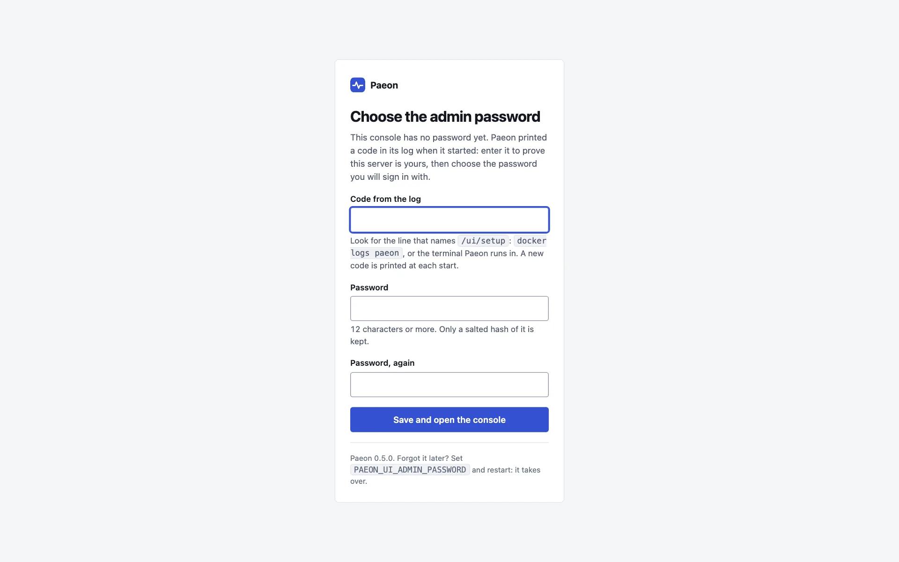
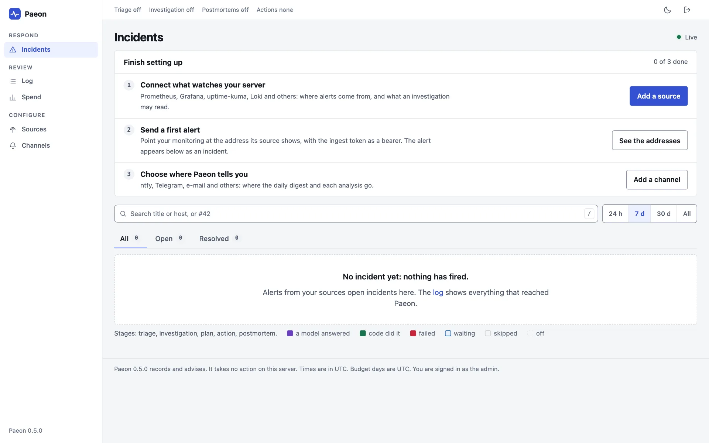

# Quickstart

One machine, no account, no model key and no file to write. In six steps you will start Paeon,
send it an alert, watch it become an incident, and finish its configuration in the console.
Nothing leaves your machine: without a rules file that enables a stage, Paeon calls no model.

You need Python 3.12 or later and [uv](https://docs.astral.sh/uv/).

!!! tip "Running Prometheus and Docker already?"

    The [Prometheus quickstart](quickstart-prometheus.md) starts a small compose project with
    Prometheus, Alertmanager and a demo service you break on purpose, and goes as far as a first
    investigated alert.

## 1. Get it

```bash
git clone https://github.com/mmornati/paeon.git && cd paeon
```

```bash
uv sync
```

## 2. Configure the minimum

Paeon needs two secrets: the token your alert senders present, and a key that protects what
the console stores. Generate both into `.env`:

```bash
echo "PAEON_INGEST_TOKEN=$(python3 -c 'import secrets; print(secrets.token_urlsafe(32))')" > .env
```

```bash
echo "PAEON_SECRET_KEY=$(python3 -c 'import secrets; print(secrets.token_urlsafe(48))')" >> .env
```

Then say that this Paeon is configured from the browser:

```bash
echo "PAEON_CONSOLE=local" >> .env
```

That one line turns the console on, makes it ask for a password, and lets you add sources and
notification channels in it. It is for a start with no rules file.

??? note "Prefer a file, kept in git?"

    Leave `PAEON_CONSOLE` out, write the [rules file](configuration.md) and name it with
    `PAEON_CONFIG`. The console is then what the file's `ui` section says, read-only by
    default, and nothing set in a browser changes what Paeon does.

## 3. Start it

```bash
set -a && . ./.env && set +a && uv run paeon serve
```

It listens on `127.0.0.1:8080` and keeps its event log in `paeon.sqlite`. Among its first lines
is one that names `/ui/setup` and ends with a code: you will need it in step 5. Leave it running
and open a second terminal in the same folder.

## 4. Send a first alert

Load the token in the second terminal:

```bash
set -a && . ./.env && set +a
```

Then post an alert the way Alertmanager would:

```bash
curl -X POST http://127.0.0.1:8080/ingest/alertmanager -H "Authorization: Bearer $PAEON_INGEST_TOKEN" -H 'Content-Type: application/json' -d '{"alerts": [{"status": "firing", "fingerprint": "demo-disk-full", "labels": {"alertname": "DiskFull", "severity": "warning", "instance": "server-1"}, "annotations": {"summary": "/ is 95 % full"}}]}'
```

Paeon answers `{"alerts":1,"changes":1}`: one alert received, one state change recorded.

## 5. See the incident

```bash
uv run paeon incidents
```

One line of JSON: incident 1, `open`, on `server-1`, with the alert attached.

Now open the console at <http://127.0.0.1:8080/ui>. The first time, it asks for the code from
the log and lets you choose the admin password.



Then the incident is there, at the top of the incident explorer under **Open**, and its page
shows what each stage did so far, with the full record one click away.

Above the explorer, **Finish setting up** lists what is left, each with its button: connect a
source (Prometheus, Grafana, uptime-kuma and others), and add a channel (ntfy, Telegram,
e-mail and others) for the daily digest. Both are forms in the console, take effect at once
and can be tested from there.



!!! warning "Before it leaves your machine"

    The password travels as you type it: put TLS in front of the console as soon as it is
    reached from another machine, and prefer a reverse proxy that authenticates when several
    people use it. See [the console](console.md).

## 6. Resolve it

Send the same alert with `resolved`:

```bash
curl -X POST http://127.0.0.1:8080/ingest/alertmanager -H "Authorization: Bearer $PAEON_INGEST_TOKEN" -H 'Content-Type: application/json' -d '{"alerts": [{"status": "resolved", "fingerprint": "demo-disk-full", "labels": {"alertname": "DiskFull", "severity": "warning", "instance": "server-1"}, "annotations": {"summary": "/ is 95 % full"}}]}'
```

The incident moves to **Resolved**. Every step you just took is one line of the event log:

```bash
uv run paeon events
```

## What you have, and what is next

You have the recording half of Paeon: alerts in, incidents out, a log of everything. No model
was called and nothing was sent anywhere. From here, each step is a decision of yours:

| You want | Go to |
|---|---|
| Your real alerts in it | **Sources** in the console, or [Connect your alerts](connect-alerts.md): uptime-kuma, Alertmanager, Grafana, OpenObserve, Gatus, Zabbix and others |
| A model to say whether an alert is noise | `triage` in [Configuration](configuration.md): one cheap call per incident, in shadow mode |
| A root cause with evidence on your phone | `investigation` in [Configuration](configuration.md), and what it sends in [Privacy and safety](privacy-and-safety.md) |
| Paeon to fix things after your Go | [Acting](acting.md): a second process, a closed catalog, and a decision of yours |
| It running for real | The hardened [compose file](https://github.com/mmornati/paeon/blob/main/examples/compose.yaml): read-only root filesystem, non-root, secrets as files, Docker through a proxy limited to `GET` |

## If it does not work

| Symptom | Cause |
|---|---|
| `paeon serve` exits at once | `PAEON_INGEST_TOKEN` is missing or shorter than 24 characters. The message says so. |
| `curl` answers 401 | The token in this terminal is not the one the server started with: run the `set -a` line again. |
| `/ui` answers 404 | `PAEON_CONSOLE=local` is not in `.env`, or, with a rules file, `ui.enabled` is not set in it. |
| The setup page refuses the code | A new code is printed at each start: use the one of the process that is running. After five wrong ones, wait a minute. |
| You forgot the admin password | Set `PAEON_UI_ADMIN_PASSWORD` (12 characters or more) and restart: it takes over the one chosen in the browser. |
| Port 8080 is taken | Add `PAEON_PORT=8090` to `.env` and use that port in the commands. |
